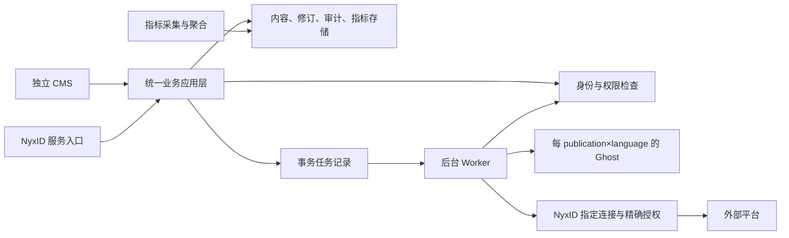

# 系统设计候选

本文件把 v0.7 转为后续实现约束；描述为设计，不表示接口或功能已经实现。正式范围见 [baseline.md](baseline.md)。

## 1. 分层与部署

采用模块化单体业务服务加独立 Worker，避免首期引入分布式微服务复杂度。控制层负责协议与输入校验，应用层编排用例，领域层定义所有权、授权及状态转换，基础设施层访问数据库、私有存储和外部服务。CMS 与 NyxID 控制器调用相同应用用例。

Ghost 的数据、配置和公开页面不依赖业务服务进程存活；预渲染内容与公开素材不能要求读者临时通过 CMS 鉴权。平台故障时，已发布页面仍可访问；Ghost 自身站点故障按站点恢复流程处理。

## 2. 领域边界

| 模块 | 单一职责 | 主要对象 |
| --- | --- | --- |
| Identity / Authorization | 验证调用人、当前组织身份、委托范围及业务权限 | Actor、MembershipAuthority、PublisherGrant |
| Workspaces / Publications | owner 隔离、渠道归属和站点映射 | Workspace、Publication、LanguageSite、DestinationConnection |
| Content / Media | 原文、修订、提交、私有素材和翻译关联 | Article、Revision、Submission、TranslationLink、Asset |
| Publishing | 冻结确认、Ghost 发布和上线核验 | Release、Confirmation、OriginalPublication |
| Distribution | 精确授权、每目标执行、对账和生命周期 | Delivery、ExecutionApproval、Attempt、FollowUp |
| Metrics | 采集、来源适配、归因、过滤与聚合 | MetricSource、Observation、Availability |
| Audit / Operations | 操作历史、特权访问、监控、备份恢复 | AuditEvent、BackupManifest、RestoreRun |

应用自有数据拟采用事务型关系数据库；Ghost 使用其支持的数据库，不直写 Ghost 表，不在 Ghost 数据库加入业务表。具体实现栈在首次编码时根据验证结果锁定并记录受支持版本。

## 3. 身份与权限

浏览器使用 NyxID Authorization Code + PKCE；验证 state、nonce、签名、issuer、audience、expiry 和回调白名单。会话、Cookie、CSRF 与注销由受保护应用统一管理。身份唯一键使用可信 issuer 与 subject，不能用 email 或前端 owner ID 代替。

NyxID 服务调用必须通过当前环境正式支持的签名身份／委托机制验证实际调用人和 scope。`X-NyxID-User-Id` 等裸请求头不能独立构成可信身份。平台范围的通用服务凭证不能替代人的所有权和成员权限检查。OIDC 身份 token、API access token、代理 identity assertion 的用途不可混用。

所有路径均执行 actor × action × owner × resource × delegated scope 检查；包含列表、搜索、下载、预览、图片、指标、取消和对账。外部传入的 owner/channel/post/revision/connection ID 只用于查找，授权依据来自服务端记录。记录 actor、owner 与 credited_author，不能互相替代。

| 角色 | 个人内容 | 组织草稿 | 组织线上内容 | 指标 |
| --- | --- | --- | --- | --- |
| 个人 owner | 管理、发布自己的内容 | 无自动授权 | 无自动授权 | 仅自己的个人指标 |
| 活跃普通成员 | 保留个人权利 | 管理自己的稿件并提交 | 禁止发布／修改／下线 | 自己组织的聚合看板 |
| 活跃 Publisher | 保留个人权利 | 自己稿件；读取／发布已提交版本 | 可确认发布、更新、下线 | 组织聚合；文章级权限按明确契约实施 |
| 活跃组织 Admin | 保留个人权利，不能查看他人的私人内容 | 同发布权限，管理 Publisher 权限 | 可确认发布、更新、下线 | 组织指标，无成员私人指标 |
| 运维 | 披露的管理权限 | 按特权流程 | 按特权流程 | 特权访问留痕 |

权限检查使用当前权威状态。退出组织、撤销发布权、撤销委托或连接禁用后，不允许排队任务继续获得新写入能力。查询失败时拒绝需要该权限的受保护操作并返回可解释错误，不用旧角色永久放行。

组织原文发布不增加 Editor 或强制二审。组织自动外部写入额外要求 NyxID Admin 对确切内容、连接／目标和动作批准，修改外部副本也适用。不能用组织通用 grant 自动替代精确批准。

## 4. 内容、修订、媒体与翻译

- Article 保存 owner、语言、逻辑身份和当前工作稿指针；Revision 不可变，包含源文件字节、编码约定、内容校验值、作者及创建时间。导入／下载保留原始换行和内容，不以 Ghost HTML 回转作为导出。
- 编辑使用 revision／ETag 条件更新，冲突明确返回，不进行 last-write-wins。全文搜索必须先限制授权范围，避免用搜索摘要泄漏草稿。
- Submission 指向确定 revision。编辑可以形成新稿，但不得偷偷改变已提交、已确认或线上版本。
- Release 固定 revision、owner、credited author、language、目的地和确认操作者，保存实际确认记录。CMS 和 NyxID 均能完成确认，无额外 CMS-only 门槛。
- TranslationLink 记录文章对与源 revision；源文变化标记过时，不自动改写或发布译文。仅在对应译文公开后生成公开链接；下线时同步清理相关公开链接。
- 草稿及未发布图片在私有存储中，通过鉴权读取或短时、绑定权限的链接访问；不可通过 Ghost 公共图片地址提前公开。发布准备仍写入私有 staging，确认对应 revision 已实际公开后才启用持久的公开资源访问；最后核验正文和图片均可达才完成发布。公开访问状态由存储／CDN 持久承载，不依赖业务服务实时鉴权。发布失败或发送前取消时素材保持私有；结果 uncertain 时先对账再决定是否公开。回收暂存素材需检查其他已发布 revision 的引用，不能误删共享资源。保留私有源与发布资源映射，并验证这一非原子转换的失败路径。
- Markdown 渲染禁用危险 HTML／协议并做输出净化。远端图片导入必须限制协议、大小、类型、重定向和网络地址，防止 XSS、SSRF 及资源耗尽。原始文件与渲染后的内容分别存储。

## 5. 发布、分发和状态机

Content、Release、Delivery 各自有状态，不能用一个全局 published 标志表示所有目标成功。

1. 公共接口校验输入、幂等键和实时权限，冻结确认版本，在数据库事务内写 Release／Delivery 与 outbox。
2. Worker 取任务后再查当前权限、确认版本及连接归属。每 owner 的 Ghost 目标由服务端映射得出。
3. 调用 Ghost 官方 Admin API，记录远端文章 ID；核对公开 URL、正确版本、署名、语言和已发布译文关系。未核验成功时不启动外部分发。
4. 每次新建／更新外部分发副本前再次核验原文仍公开、版本与批准一致；等待批准／人工延迟期间原文被更新或下线时阻止该写入，不能永久复用旧核验结果。移除已知副本和只读对账不要求原文仍在线，但继续校验当前权限、连接归属及适用的精确批准。绑定确切 NyxID connection ID，不依赖默认 slug 账号选择，也不回退到个人账号或供应商直连。
5. 自动组织写入在执行前核验精确批准；确认／批准应覆盖内容摘要、revision、图片、全文或摘要形式、目标账号及 create/update/remove 动作。改变这些要素必须重新授权。
6. 每目标保存远端 ID、实际写入账号、URL、revision、尝试及结果证据。跟踪 source link／canonical 的实际状态，不保证 SEO 排名或反链价值。

Delivery 状态至少包含：`approval_needed`、`manual_action_needed`、`queued`、`submitted`、`published`、`failed`、`uncertain`、`cancelled`；纠错和移除用独立动作记录及人工跟进状态。只有经核验公开后才能标 published。

出站写请求发出后超时必须转 uncertain。先查询远端／校验幂等证据，再决定是否重试；没有可证明结果时要求人工处理。不能承诺供应商没有提供的 exactly-once 语义。一个目标失败不改变其他目标的成功记录。

取消尚未发送的任务阻止写入；已发出的请求无法保证撤回，要继续对账并显示可能产生的远端副本。移除原文不自动证明外部副本已移除。遗失原作者账号／平台不支持删除时建立待人工跟进记录。

| 平台 | 必需路径 | 执行边界 |
| --- | --- | --- |
| DEV | 个人与组织自动发布 | 验证组织权限、署名账号、原作者更新权、限流及实际查询能力 |
| Hashnode | 组织自动发布 | 验证目标 Pro publication 和账号角色；个人支持未选择 |
| Medium | 辅助导入／提交 | 准备内容、图片、原文链接并记录结果，不能报为自动发布 |
| HackerNoon | 辅助提交及审核跟踪 | 验证公司账号要求，接受和发布时间由平台控制 |

## 6. API 契约范围

具体路径尚未发布。OpenAPI 必须覆盖：工作区选择；当前有权组织 Admin 授予／撤销 Publisher（禁止自提权）；文章列表／搜索／读取；草稿创建／编辑／导入；提交 revision；确认发布／更新／下线；请求分发／取消／纠错／移除／查询状态；指定语言和 revision 的 Markdown 下载；workspace／article 指标查询。

读接口和写接口共用授权规则。分页有上限，文件有大小与类型边界；条件更新、幂等、可重试性、部分成功、需要批准／人工操作／缺订阅等错误必须形成机器可读契约。错误统一返回安全摘要、稳定 code 与 Trace ID，不返回密钥或底层授权头。

## 7. 指标

自托管 Ghost 的采集源在阶段 0 验证；不能把 Ghost(Pro) 的托管可用性当作自托管平台已有能力。Native Analytics／Tinybird 与独立采集方案均是候选，选择时比较自托管支持、查询接口、隔离、隐私及成本。

平台 MetricsService 提供日期、文章、语言、destination 过滤，CMS 与 NyxID 调用同一聚合逻辑。提供 PV、定义明确的估算 UV、热门文章、referrer／campaign、趋势和分发数量。无法归因的流量单列；不同平台受众不合并成去重读者。

数据项返回 value、availability、source、updated_at 和覆盖范围；不可用以 null＋Unavailable 原因表示，不填 0。外部阅读／互动仅接入支持且已授权的来源。组织成员可查看聚合看板，个人数据仅 owner；私有草稿／预览不采集。客户端不能通过伪造 owner/article 字段把访问写进其他租户；采集故障不阻断发布。

## 8. 模式、可靠性与运维

Adapter 隔离 Ghost、NyxID、各分发目标与指标源；Capability 描述支持的动作，缺少能力明确返回而不自动换路径。Policy 封装统一授权；显式状态机管理发布生命周期；事务 outbox 避免数据库提交与任务入队之间丢任务。采用这些模式是为了验证边界与故障恢复，不为每个模块建立独立服务。

所有业务链路传播 Trace ID；异常统一捕获并记录脱敏诊断。对外调用设置超时、响应大小、重试类别与可取消信号。网络连接、监听器、定时器和任务租约必须有关闭／回收路径。高频列表／队列／指标查询需 owner、状态、日期等索引，禁止全量扫描后在内存中过滤租户权限。

备份覆盖平台数据库、Markdown／私有和公开素材、Ghost 数据库及 content、站点配置／主题、发布与审批审计、远端映射；凭证依其密钥管理体系加密备份和恢复，不能打包进普通导出。恢复在隔离环境演练，出站任务先暂停，再重验实时权限及远端状态，防止重复分发。RPO／RTO 和保留期限在生产前明确。

支持版本与镜像摘要按实际实验记录。升级先验证契约／渲染／鉴权和备份恢复，再逐站灰度。接口不存在或能力不满足时记为缺口，不通过修改 Ghost 核心或绕过 NyxID 解决。
