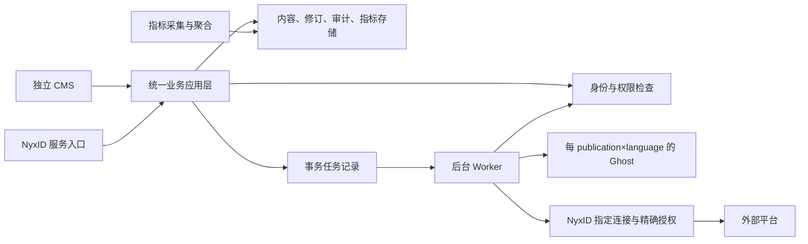

# 系统设计候选

# Candidate System Design

本文件把 v0.7 转为后续实现约束；描述为设计，不表示接口或功能已经实现。正式范围见 [baseline.md](baseline.md)。

This document turns v0.7 into constraints for subsequent implementation. It describes a design and does not claim that the interfaces or features are already implemented. The formal scope is defined in [baseline.md](baseline.md).

当前权威需求见 [docs/source/requirements.md](source/requirements.md) 与 [docs/source/supporting-deliverables.md](source/supporting-deliverables.md)；当前实现和验证状态见 [docs/delivery-status.md](delivery-status.md) 与 [docs/acceptance.md](acceptance.md)。本文件保留候选设计定位，不能替代这些权威需求、实现或验收记录。

The current authoritative requirements are [docs/source/requirements.md](source/requirements.md) and [docs/source/supporting-deliverables.md](source/supporting-deliverables.md). Current implementation and verification status are recorded in [docs/delivery-status.md](delivery-status.md) and [docs/acceptance.md](acceptance.md). This file remains a candidate design and does not replace those authoritative requirements, implementation records, or acceptance records.

## 1. 分层与部署

## 1. Layering and Deployment

采用模块化单体业务服务加独立 Worker，避免首期引入分布式微服务复杂度。控制层负责协议与输入校验，应用层编排用例，领域层定义所有权、授权及状态转换，基础设施层访问数据库、私有存储和外部服务。CMS 与 NyxID 控制器调用相同应用用例。

Use a modular monolithic business service with an independent Worker to avoid introducing distributed-microservice complexity in the first phase. The control layer handles protocols and input validation; the application layer orchestrates use cases; the domain layer defines ownership, authorization, and state transitions; and the infrastructure layer accesses the database, private storage, and external services. The CMS and NyxID controllers call the same application use cases.

The flow is: the standalone CMS and NyxID service entry point call one unified application layer; that layer checks identity and permissions, stores content/revisions/audit/metrics, and records transactional tasks. A background Worker rechecks policy, then reaches the Ghost instance for each publication and language, the specifically selected NyxID connection with exact authorization, and external platforms. Metrics collection and aggregation write to the same store.

Ghost 的数据、配置和公开页面不依赖业务服务进程存活；预渲染内容与公开素材不能要求读者临时通过 CMS 鉴权。平台故障时，已发布页面仍可访问；Ghost 自身站点故障按站点恢复流程处理。

Ghost data, configuration, and public pages do not depend on the business service process remaining alive; prerendered content and public assets must not require readers to pass temporary CMS authentication. During a platform failure, already published pages remain accessible. A failure of a Ghost site itself follows the recovery procedure for that site.

## 2. 领域边界

## 2. Domain Boundaries

| 模块 | 单一职责 | 主要对象 |
| --- | --- | --- |
| Identity / Authorization | 验证调用人、当前组织身份、委托范围及业务权限 | Actor、MembershipAuthority、PublisherGrant |
| Workspaces / Publications | owner 隔离、渠道归属和站点映射 | Workspace、Publication、LanguageSite、DestinationConnection |
| Content / Media | 原文、修订、提交、私有素材和翻译关联 | Article、Revision、Submission、TranslationLink、Asset |
| Publishing | 冻结确认、Ghost 发布和上线核验 | Release、Confirmation、OriginalPublication |
| Distribution | 精确授权、每目标执行、对账和生命周期 | Delivery、ExecutionApproval、Attempt、FollowUp |
| Metrics | 采集、来源适配、归因、过滤与聚合 | MetricSource、Observation、Availability |
| Audit / Operations | 操作历史、特权访问、监控、备份恢复 | AuditEvent、BackupManifest、RestoreRun |

| Module | Single responsibility | Main objects |
| --- | --- | --- |
| Identity / Authorization | Verify caller, current organization identity, delegated scope, and business permissions | Actor, MembershipAuthority, PublisherGrant |
| Workspaces / Publications | Isolate owners, assign channels, and map sites | Workspace, Publication, LanguageSite, DestinationConnection |
| Content / Media | Manage source content, revisions, submissions, private assets, and translation links | Article, Revision, Submission, TranslationLink, Asset |
| Publishing | Freeze confirmations, publish to Ghost, and verify availability | Release, Confirmation, OriginalPublication |
| Distribution | Exact authorization, per-target execution, reconciliation, and lifecycle | Delivery, ExecutionApproval, Attempt, FollowUp |
| Metrics | Collection, source adaptation, attribution, filtering, and aggregation | MetricSource, Observation, Availability |
| Audit / Operations | Operation history, privileged access, monitoring, backup, and recovery | AuditEvent, BackupManifest, RestoreRun |

应用自有数据拟采用事务型关系数据库；Ghost 使用其支持的数据库，不直写 Ghost 表，不在 Ghost 数据库加入业务表。具体实现栈在首次编码时根据验证结果锁定并记录受支持版本。

Application-owned data is intended to use a transactional relational database. Ghost uses a database it supports; the application does not write Ghost tables directly or add business tables to the Ghost database. The concrete implementation stack and supported versions are locked and recorded during the first implementation phase based on verification results.

## 3. 身份与权限

## 3. Identity and Authorization

浏览器使用 NyxID Authorization Code + PKCE；验证 state、nonce、签名、issuer、audience、expiry 和回调白名单。会话、Cookie、CSRF 与注销由受保护应用统一管理。身份唯一键使用可信 issuer 与 subject，不能用 email 或前端 owner ID 代替。

The browser uses NyxID Authorization Code + PKCE. Validate state, nonce, signature, issuer, audience, expiry, and the callback allowlist. The protected application centrally manages sessions, cookies, CSRF, and logout. The identity key uses the trusted issuer and subject; email or a frontend owner ID cannot substitute for it.

NyxID 服务调用必须通过当前环境正式支持的签名身份／委托机制验证实际调用人和 scope。`X-NyxID-User-Id` 等裸请求头不能独立构成可信身份。平台范围的通用服务凭证不能替代人的所有权和成员权限检查。OIDC 身份 token、API access token、代理 identity assertion 的用途不可混用。

NyxID service calls must verify the actual caller and scope through the signed identity or delegation mechanism formally supported by the current environment. A bare request header such as `X-NyxID-User-Id` cannot independently establish a trusted identity. A platform-wide generic service credential cannot replace a person's ownership and membership checks. OIDC identity tokens, API access tokens, and delegated identity assertions must not be used interchangeably.

所有路径均执行 actor × action × owner × resource × delegated scope 检查；包含列表、搜索、下载、预览、图片、指标、取消和对账。外部传入的 owner/channel/post/revision/connection ID 只用于查找，授权依据来自服务端记录。记录 actor、owner 与 credited_author，不能互相替代。

Every path performs an actor × action × owner × resource × delegated-scope check, including listing, search, download, preview, image, metrics, cancellation, and reconciliation. Externally supplied owner, channel, post, revision, and connection IDs are used only for lookup; authorization is based on server-side records. Record actor, owner, and credited author separately; they cannot substitute for one another.

| 角色 | 个人内容 | 组织草稿 | 组织线上内容 | 指标 |
| --- | --- | --- | --- | --- |
| 个人 owner | 管理、发布自己的内容 | 无自动授权 | 无自动授权 | 仅自己的个人指标 |
| 活跃普通成员 | 保留个人权利 | 管理自己的稿件并提交 | 禁止发布／修改／下线 | 自己组织的聚合看板 |
| 活跃 Publisher | 保留个人权利 | 自己稿件；读取／发布已提交版本 | 可确认发布、更新、下线 | 组织聚合；文章级权限按明确契约实施 |
| 活跃组织 Admin | 保留个人权利，不能查看他人的私人内容 | 同发布权限，管理 Publisher 权限 | 可确认发布、更新、下线 | 组织指标，无成员私人指标 |
| 运维 | 披露的管理权限 | 按特权流程 | 按特权流程 | 特权访问留痕 |

| Role | Personal content | Organization drafts | Published organization content | Metrics |
| --- | --- | --- | --- | --- |
| Personal owner | Manage and publish own content | No automatic authorization | No automatic authorization | Only own personal metrics |
| Active ordinary member | Retains personal rights | Manage and submit own drafts | Cannot publish, modify, or unpublish | Aggregated dashboard for the member's organization |
| Active Publisher | Retains personal rights | Own drafts; read and publish submitted revisions | May confirm publication, update, and unpublish | Organization aggregate; article-level access follows the explicit contract |
| Active organization Admin | Retains personal rights and cannot view others' private content | Same publication rights and manages Publisher permissions | May confirm publication, update, and unpublish | Organization metrics, without members' private metrics |
| Operations | Disclosed administrative permissions | Through privileged procedures | Through privileged procedures | Privileged access is recorded |

权限检查使用当前权威状态。退出组织、撤销发布权、撤销委托或连接禁用后，不允许排队任务继续获得新写入能力。查询失败时拒绝需要该权限的受保护操作并返回可解释错误，不用旧角色永久放行。

Permission checks use the current authoritative state. After leaving an organization, revoking publication rights, revoking delegation, or disabling a connection, queued tasks cannot gain new write capability. If a lookup fails, reject the protected operation that requires the permission and return an explainable error; do not grant permanent access based on an old role.

组织原文发布不增加 Editor 或强制二审。组织自动外部写入额外要求 NyxID Admin 对确切内容、连接／目标和动作批准，修改外部副本也适用。不能用组织通用 grant 自动替代精确批准。

Publishing an organization original does not add an Editor role or require a second review. Automated organization writes additionally require a NyxID Admin to approve the exact content, connection or target, and action; the same applies when modifying an external copy. A generic organization grant cannot automatically replace exact approval.

## 4. 内容、修订、媒体与翻译

## 4. Content, Revisions, Media, and Translation

- Article 保存 owner、语言、逻辑身份和当前工作稿指针；Revision 不可变，包含源文件字节、编码约定、内容校验值、作者及创建时间。导入／下载保留原始换行和内容，不以 Ghost HTML 回转作为导出。
- Article stores the owner, language, logical identity, and pointer to the current working draft. A Revision is immutable and contains source-file bytes, encoding conventions, a content checksum, author, and creation time. Import and download preserve original line breaks and content; Ghost HTML round-tripping is not used as export.
- 编辑使用 revision／ETag 条件更新，冲突明确返回，不进行 last-write-wins。全文搜索必须先限制授权范围，避免用搜索摘要泄漏草稿。
- Editing uses conditional revision/ETag updates and returns conflicts explicitly; it does not use last-write-wins. Full-text search must first be restricted to the authorized scope so that search snippets cannot leak drafts.
- Submission 指向确定 revision。编辑可以形成新稿，但不得偷偷改变已提交、已确认或线上版本。
- A Submission points to a specific revision. Editing may create a new draft, but must not silently change a submitted, confirmed, or published version.
- Release 固定 revision、owner、credited author、language、目的地和确认操作者，保存实际确认记录。CMS 和 NyxID 均能完成确认，无额外 CMS-only 门槛。
- A Release fixes the revision, owner, credited author, language, destination, and confirming operator, and stores the actual confirmation record. Both CMS and NyxID can confirm it; there is no additional CMS-only gate.
- TranslationLink 记录文章对与源 revision；源文变化标记过时，不自动改写或发布译文。仅在对应译文公开后生成公开链接；下线时同步清理相关公开链接。
- TranslationLink records the article pair and source revision. A source change marks the translation outdated; it does not rewrite or publish the translation automatically. Generate a public link only after the corresponding translation is public, and remove related public links when it is unpublished.
- 草稿及未发布图片在私有存储中，通过鉴权读取或短时、绑定权限的链接访问；不可通过 Ghost 公共图片地址提前公开。发布准备仍写入私有 staging，确认对应 revision 已实际公开后才启用持久的公开资源访问；最后核验正文和图片均可达才完成发布。公开访问状态由存储／CDN 持久承载，不依赖业务服务实时鉴权。发布失败或发送前取消时素材保持私有；结果 uncertain 时先对账再决定是否公开。回收暂存素材需检查其他已发布 revision 的引用，不能误删共享资源。保留私有源与发布资源映射，并验证这一非原子转换的失败路径。
- Drafts and unpublished images remain in private storage and are read through authorization or short-lived, permission-bound links; they cannot be exposed early through a public Ghost image URL. Publication preparation remains in private staging. Enable durable public asset access only after confirming that the target revision is actually public, and complete publication only after verifying that both body and image are reachable. Storage/CDN durably carries public access state rather than relying on real-time business-service authorization. Keep assets private when publication fails or is cancelled before sending; when the result is uncertain, reconcile first and then decide whether to publish. Before reclaiming staged assets, check references from other published revisions so shared resources are not deleted accidentally. Preserve private-source and published-resource mappings and verify failure paths in this non-atomic transition.
- Markdown 渲染禁用危险 HTML／协议并做输出净化。远端图片导入必须限制协议、大小、类型、重定向和网络地址，防止 XSS、SSRF 及资源耗尽。原始文件与渲染后的内容分别存储。
- Markdown rendering disables dangerous HTML/protocols and sanitizes output. Remote image import must restrict protocol, size, type, redirects, and network addresses to prevent XSS, SSRF, and resource exhaustion. Store original files separately from rendered content.

## 5. 发布、分发和状态机

## 5. Publishing, Distribution, and the State Machine

Content、Release、Delivery 各自有状态，不能用一个全局 published 标志表示所有目标成功。

Content, Release, and Delivery each have their own state; one global `published` flag cannot represent success for every target.

1. 公共接口校验输入、幂等键和实时权限，冻结确认版本，在数据库事务内写 Release／Delivery 与 outbox。
2. Worker 取任务后再查当前权限、确认版本及连接归属。每 owner 的 Ghost 目标由服务端映射得出。
3. 调用 Ghost 官方 Admin API，记录远端文章 ID；核对公开 URL、正确版本、署名、语言和已发布译文关系。未核验成功时不启动外部分发。
4. 每次新建／更新外部分发副本前再次核验原文仍公开、版本与批准一致；等待批准／人工延迟期间原文被更新或下线时阻止该写入，不能永久复用旧核验结果。移除已知副本和只读对账不要求原文仍在线，但继续校验当前权限、连接归属及适用的精确批准。绑定确切 NyxID connection ID，不依赖默认 slug 账号选择，也不回退到个人账号或供应商直连。
5. 自动组织写入在执行前核验精确批准；确认／批准应覆盖内容摘要、revision、图片、全文或摘要形式、目标账号及 create/update/remove 动作。改变这些要素必须重新授权。
6. 每目标保存远端 ID、实际写入账号、URL、revision、尝试及结果证据。跟踪 source link／canonical 的实际状态，不保证 SEO 排名或反链价值。

1. Public interfaces validate input, idempotency keys, and current permissions, freeze the confirmed version, and write Release/Delivery and the outbox in one database transaction.
2. After taking a task, the Worker checks current permissions, the confirmed version, and connection ownership again. The server-side mapping determines each owner's Ghost target.
3. Call the official Ghost Admin API and record the remote article ID. Verify the public URL, correct version, attribution, language, and published translation relationship. Do not start external distribution until verification succeeds.
4. Before creating or updating an external distribution copy, verify again that the original remains public and that the version and approval match. If the original is updated or unpublished while approval or a manual delay is pending, block the write; do not reuse an old verification forever. Removing a known copy and performing read-only reconciliation do not require the original to remain online, but still require current permission, connection ownership, and applicable exact approval checks. Bind the exact NyxID connection ID; do not rely on default slug account selection or fall back to a personal account or direct vendor connection.
5. Before an automated organization write, verify exact approval. Confirmation/approval must cover the content digest, revision, image, full-text or summary form, target account, and create/update/remove action. Changing any of these elements requires reauthorization.
6. Store the remote ID, actual writing account, URL, revision, attempts, and result evidence for every target. Track the actual source-link/canonical state and do not guarantee SEO ranking or backlink value.

Delivery 状态至少包含：`approval_needed`、`manual_action_needed`、`queued`、`submitted`、`published`、`failed`、`uncertain`、`cancelled`；纠错和移除用独立动作记录及人工跟进状态。只有经核验公开后才能标 published。

Delivery must include at least these states: `approval_needed`, `manual_action_needed`, `queued`, `submitted`, `published`, `failed`, `uncertain`, and `cancelled`. Corrections and removals use separate action records and manual follow-up states. Mark a delivery `published` only after public availability has been verified.

出站写请求发出后超时必须转 uncertain。先查询远端／校验幂等证据，再决定是否重试；没有可证明结果时要求人工处理。不能承诺供应商没有提供的 exactly-once 语义。一个目标失败不改变其他目标的成功记录。

After an outbound write request is sent, a timeout must become `uncertain`. Query the remote and verify idempotency evidence before deciding whether to retry; require manual handling when no result can be proven. Do not promise exactly-once semantics that a vendor does not provide. Failure of one target does not change the success record of another target.

取消尚未发送的任务阻止写入；已发出的请求无法保证撤回，要继续对账并显示可能产生的远端副本。移除原文不自动证明外部副本已移除。遗失原作者账号／平台不支持删除时建立待人工跟进记录。

Cancel a task before it is sent to block the write. A request that has already been sent cannot be guaranteed to retract; continue reconciliation and show that a remote copy may exist. Removing the original does not automatically prove that an external copy was removed. If the original author's account is unavailable or a platform does not support deletion, create a manual follow-up record.

| 平台 | 必需路径 | 执行边界 |
| --- | --- | --- |
| DEV | 个人与组织自动发布 | 验证组织权限、署名账号、原作者更新权、限流及实际查询能力 |
| Hashnode | 组织自动发布 | 验证目标 Pro publication 和账号角色；个人支持未选择 |
| Medium | 辅助导入／提交 | 准备内容、图片、原文链接并记录结果，不能报为自动发布 |
| HackerNoon | 辅助提交及审核跟踪 | 验证公司账号要求，接受和发布时间由平台控制 |

| Platform | Required path | Execution boundary |
| --- | --- | --- |
| DEV | Automatic personal and organization publishing | Verify organization permissions, credited account, original-author update rights, rate limits, and actual query capability |
| Hashnode | Automatic organization publishing | Verify the target Pro publication and account role; personal support is not selected |
| Medium | Assisted import/submission | Prepare content, images, and original link and record the result; do not report it as automatic publishing |
| HackerNoon | Assisted submission and review tracking | Verify company-account requirements; the platform controls acceptance and publication time |

## 6. API 契约范围

## 6. API Contract Scope

具体路径尚未发布。OpenAPI 必须覆盖：工作区选择；当前有权组织 Admin 授予／撤销 Publisher（禁止自提权）；文章列表／搜索／读取；草稿创建／编辑／导入；提交 revision；确认发布／更新／下线；请求分发／取消／纠错／移除／查询状态；指定语言和 revision 的 Markdown 下载；workspace／article 指标查询。

Concrete paths have not yet been published. OpenAPI must cover workspace selection; granting/revoking Publisher by an authorized organization Admin (with self-escalation prohibited); article listing/search/reading; draft creation/editing/import; revision submission; confirmation of publication/update/unpublish; distribution request/cancellation/correction/removal/status queries; Markdown download for a specified language and revision; and workspace/article metrics queries.

读接口和写接口共用授权规则。分页有上限，文件有大小与类型边界；条件更新、幂等、可重试性、部分成功、需要批准／人工操作／缺订阅等错误必须形成机器可读契约。错误统一返回安全摘要、稳定 code 与 Trace ID，不返回密钥或底层授权头。

Read and write interfaces share authorization rules. Pagination has limits, and files have size and type boundaries. Conditional updates, idempotency, retryability, partial success, approval/manual-action requirements, and missing-subscription errors must form a machine-readable contract. Errors consistently return a safe summary, stable code, and Trace ID, without returning secrets or underlying authorization headers.

## 7. 指标

## 7. Metrics

自托管 Ghost 的采集源在阶段 0 验证；不能把 Ghost(Pro) 的托管可用性当作自托管平台已有能力。Native Analytics／Tinybird 与独立采集方案均是候选，选择时比较自托管支持、查询接口、隔离、隐私及成本。

The collection source for self-hosted Ghost is validated in phase 0; hosted availability of Ghost(Pro) cannot be treated as an existing capability of the self-hosted platform. Native Analytics/Tinybird and an independent collection design are candidates. Compare self-hosting support, query interfaces, isolation, privacy, and cost when selecting one.

平台 MetricsService 提供日期、文章、语言、destination 过滤，CMS 与 NyxID 调用同一聚合逻辑。提供 PV、定义明确的估算 UV、热门文章、referrer／campaign、趋势和分发数量。无法归因的流量单列；不同平台受众不合并成去重读者。

The platform MetricsService provides date, article, language, and destination filters, and CMS and NyxID call the same aggregation logic. It provides PV, a clearly defined estimated UV, popular articles, referrer/campaign data, trends, and distribution counts. Unattributable traffic is listed separately; audiences from different platforms are not merged into deduplicated readers.

数据项返回 value、availability、source、updated_at 和覆盖范围；不可用以 null＋Unavailable 原因表示，不填 0。外部阅读／互动仅接入支持且已授权的来源。组织成员可查看聚合看板，个人数据仅 owner；私有草稿／预览不采集。客户端不能通过伪造 owner/article 字段把访问写进其他租户；采集故障不阻断发布。

Each data item returns value, availability, source, updated_at, and coverage. Unavailable data is represented by null plus an Unavailable reason, not by 0. External reading/interaction is integrated only from supported and authorized sources. Organization members may view aggregate dashboards, while personal data is restricted to the owner; private drafts/previews are not collected. A client cannot write access into another tenant by forging owner/article fields, and collection failure does not block publishing.

## 8. 模式、可靠性与运维

## 8. Patterns, Reliability, and Operations

Adapter 隔离 Ghost、NyxID、各分发目标与指标源；Capability 描述支持的动作，缺少能力明确返回而不自动换路径。Policy 封装统一授权；显式状态机管理发布生命周期；事务 outbox 避免数据库提交与任务入队之间丢任务。采用这些模式是为了验证边界与故障恢复，不为每个模块建立独立服务。

Adapters isolate Ghost, NyxID, each distribution target, and each metrics source. Capability describes supported actions; when a capability is missing, return it explicitly rather than switching paths automatically. Policy encapsulates unified authorization; an explicit state machine manages the publication lifecycle; and a transactional outbox prevents loss between database commit and task enqueue. These patterns are chosen to verify boundaries and failure recovery, not to create an independent service for every module.

所有业务链路传播 Trace ID；异常统一捕获并记录脱敏诊断。对外调用设置超时、响应大小、重试类别与可取消信号。网络连接、监听器、定时器和任务租约必须有关闭／回收路径。高频列表／队列／指标查询需 owner、状态、日期等索引，禁止全量扫描后在内存中过滤租户权限。

Propagate a Trace ID through every business path; capture exceptions uniformly and record sanitized diagnostics. External calls have timeouts, response-size limits, retry categories, and cancellation signals. Network connections, listeners, timers, and task leases must have explicit close/release paths. High-frequency list, queue, and metrics queries need owner, state, and date indexes; do not scan everything and filter tenant permissions in memory.

备份覆盖平台数据库、Markdown／私有和公开素材、Ghost 数据库及 content、站点配置／主题、发布与审批审计、远端映射；凭证依其密钥管理体系加密备份和恢复，不能打包进普通导出。恢复在隔离环境演练，出站任务先暂停，再重验实时权限及远端状态，防止重复分发。RPO／RTO 和保留期限在生产前明确。

Backups cover the platform database, Markdown, private and public assets, the Ghost database and content, site configuration/themes, publication and approval audit records, and remote mappings. Credentials are encrypted for backup and recovery according to their key-management system and cannot be bundled into an ordinary export. Exercise recovery in an isolated environment, pause outbound tasks first, then recheck current permissions and remote state to prevent duplicate distribution. Define RPO/RTO and retention periods before production.

支持版本与镜像摘要按实际实验记录。升级先验证契约／渲染／鉴权和备份恢复，再逐站灰度。接口不存在或能力不满足时记为缺口，不通过修改 Ghost 核心或绕过 NyxID 解决。

Record supported versions and image digests from actual experiments. Before upgrading, verify contracts, rendering, authorization, and backup recovery, then roll out site by site. Record a missing interface or unsupported capability as a gap; do not solve it by modifying Ghost core or bypassing NyxID.
